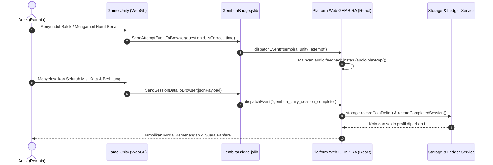

# 🏝️ GEMBIRA — Platform Belajar Interaktif Berbasis Permainan (PKM-KC)

> **"Tanpa Buku, Asyik Bermain!"**  
> Platform gamifikasi edukasi terpadu untuk anak usia dini (PAUD) hingga Sekolah Dasar (Fase A, B, C) yang menggabungkan web modern interaktif dan game engine **Unity 2D**.

[](https://react.dev/)
[](https://www.typescriptlang.org/)
[](https://vitejs.dev/)
[](https://tailwindcss.com/)
[](https://unity.com/)
[](#tentang-gembira)

---

## 📋 Daftar Isi

1. [Tentang GEMBIRA](#-tentang-gembira)
2. [Nilai Kebaruan (Novelty PKM-KC)](#-nilai-kebaruan-novelty-pkm-kc)
3. [Fitur Unggulan](#-fitur-unggulan)
   - [Peta Petualangan Kepulauan](#1-peta-petualangan-kepulauan-adventure-map)
   - [Arena Mini-Game Edukasi](#2-arena-mini-game-edukasi)
   - [Integrasi Unity Engine 2D Platformer](#3-game-unity-2d-petualangan-pulau-kata--angka)
   - [8 Modul Pembelajaran Usia Dini](#4-8-modul-pembelajaran-interaktif-usia-dini)
   - [Dashboard Orang Tua & Diagnostik Kemampuan](#5-dashboard-orang-tua--diagnostik-berbasis-akurasi)
   - [Phygital Quests (Misi Dunia Nyata)](#6-phygital-quests-misi-nyata-di-rumah)
   - [Tantangan Suara AI (Speech Recognition)](#7-tantangan-suara-interaktif-speech-recognition)
   - [Lemari Kostum & Maskot Tamagotchi](#8-lemari-kostum-avatar--buddy-happiness)
   - [Peringkat Ramah Anak (Safe Leaderboard)](#9-peringkat-mingguan-ramah-anak)
4. [Arsitektur & Struktur Direktori](#-arsitektur--struktur-direktori)
5. [Jembatan Komunikasi Unity WebGL ↔ React (JSBridge)](#-jembatan-komunikasi-unity-webgl--react-jsbridge)
6. [Panduan Instalasi & Menjalankan Proyek](#-panduan-instalasi--menjalankan-proyek)
   - [A. Menjalankan Platform Web](#a-menjalankan-platform-web)
   - [B. Menjalankan & Mem-build Game Unity](#b-menjalankan--mem-build-game-unity-engine)
7. [Prinsip Pedagogi & Keamanan Ramah Anak](#-prinsip-pedagogi--keamanan-ramah-anak)
8. [Palet Warna Identitas GEMBIRA](#-palet-warna-identitas-gembira)

---

## 🌟 Tentang GEMBIRA

**GEMBIRA** dirancang sebagai solusi atas permasalahan kejenuhan belajar anak usia dini dan ketergantungan pada buku teks konvensional yang pasif. Dengan pendekatan *play-based learning*, anak diajak berpetualang menelusuri pulau-pulau pengetahuan sambil menyelesaikan tantangan numerasi, literasi, persepsi visual, motorik halus, dan kecerdasan sosio-emosional.

Platform ini memisahkan dua peran utama:
- **Anak (Pengguna Utama)**: Mengalami antarmuka penuh warna, umpan balik visual-auditori positif tanpa hukuman, kontrol ramah sentuhan, dan motivasi koin/bintang.
- **Orang Tua / Pendidik (Pemilik Akun & Pemantau)**: Memiliki area khusus berpelindung *Parent Gate (PIN)* untuk memantau kemajuan riil anak berdasarkan akurasi attempt dan rekomendasi aktivitas luring di rumah.

---

## 💡 Nilai Kebaruan (Novelty PKM-KC)

Dibandingkan aplikasi edukasi anak pada umumnya, GEMBIRA memiliki kebaruan:
1. **Dual-Engine Synergy**: Menggabungkan arsitektur web responsif PWA (React + Tailwind) dengan grafis dan interaktivitas fisika imersif dari **Unity Engine 2D**.
2. **Arsitektur Koin Anti-Farming & Ledger**: Koin dihitung berbasis sesi dan attempt unik, bukan sekadar penekanan tombol berulang.
3. **Phygital Learning Integration**: Misi hibrida yang menjembatani aktivitas digital dengan interaksi fisik nyata bersama keluarga (orang tua memverifikasi stempel emas).
4. **Diagnostik Kemampuan Riil**: Analisis tumbuh kembang dihitung dari 20 *attempt* terakhir per domain (bukan sekadar menghitung berapa kali aplikasi dibuka).
5. **Synthesizer Audio Zero-Asset**: Efek suara dibangkitkan secara prosedural menggunakan Web Audio API, menjaga ukuran bundle tetap ringan dan responsif pada perangkat berspesifikasi hemat (low-end device).

---

## 🚀 Fitur Unggulan

### 1. Peta Petualangan Kepulauan (Adventure Map)
- Visualisasi pulau bertema: **Pulau Angka Ajaib**, **Pulau Huruf Nusantara**, **Pulau Usia Dini**, **Pulau Detektif Nyata**, dan **Pulau Petualangan 2D Unity**.
- Navigasi interaktif dengan penanda progres bintang, koin terkumpul, dan tombol langsung melanjutkan level terakhir.

### 2. Arena Mini-Game Edukasi
Tersedia 7 game pembelajaran aktif:
| Game | Domain | Mekanik Inti |
|---|---|---|
| **Letus Balon Deluxe** | Numerasi | Memecahkan balon penjumlahan/pengurangan, combo streak, opsi mode santai / 45 detik. |
| **Tangkap Buah** | Numerasi & Refleks | Menggeser keranjang buah untuk menangkap buah dengan hasil hitung yang tepat. |
| **Susun Kata Nusantara** | Literasi | Melengkapi huruf alfabet yang hilang pada kosakata baku bahasa Indonesia. |
| **Orkestra Melodi Ajaib** | Auditori & Musik | Menirukan ketukan nada tangga suara instrumen satwa (latihan memori audio). |
| **Cocok Bayangan Ajaib** | Persepsi Visual | Memasangkan siluet hitam objek dengan kartu berwarna yang cocok. |
| **Labirin Jejak Sahabat** | Spasial & Logika | Memandu hewan lucu keluar dari labirin menggunakan navigasi arah terencana. |
| **Petualangan 2D (Unity)** | Literasi & Numerasi | Melompat mengambil huruf alfabet dan menyundul balok jawaban berhitung. |

### 3. Game Unity 2D ("Petualangan Pulau Kata & Angka")
Game platformer lengkap berbasis **Unity Engine** di dalam folder `unity-platformer/`:
- **Fisika Halus Ramah Anak**: Dilengkapi *Coyote Time* dan *Jump Buffer* agar anak tidak mudah gagal saat melompat.
- **Sistem Respawn Lembut**: Karakter yang terjatuh tidak mengalami *Game Over*, melainkan kembali ke checkpoint terdekat dengan efek suara ramah (*anti-frustration design*).
- **Misi Kata Terpadu**: Mengumpulkan huruf terapung untuk menyusun kata (contoh: `K - U - C - I - N - G`).
- **Balok Sundul Interaktif**: Menyundul balok angka seperti Super Mario untuk membuka jembatan atau gerbang.
- **Dukungan Mobile & Layar Sentuh**: D-pad dan tombol virtual *On-Screen* otomatis aktif di perangkat sentuh.

### 4. 8 Modul Pembelajaran Interaktif Usia Dini
Modul kurikulum terstruktur untuk anak usia 4–7 tahun:
- **M1 Mengenal Warna**: Identifikasi warna primer dan sekunder.
- **M2 Bentuk Geometri**: Pengenalan bentuk lingkaran, segitiga, persegi, dan bintang.
- **M3 Hitung Hewan**: Latihan membilang kuantitas 1–10.
- **M4 Dongeng Nilai Moral**: Cerita bercabang interaktif tentang kejujuran dan gotong royong.
- **M5 Suara Satwa**: Tebak suara hewan asli disertai fakta sains mini.
- **M6 Hitung Buah**: Perbandingan kuantitas lebih banyak / lebih sedikit.
- **M7 Memori Kartu**: Permainan balik kartu mencocokkan pasangan objek.
- **M8 Emosi & Karakter**: Mengenal mimik ekspresi wajah (senang, sedih, berani, tenang).

### 5. Dashboard Orang Tua & Diagnostik Berbasis Akurasi
- Terlindungi oleh **Parent Gate** (PIN 4 digit) agar tidak sembarang dibuka oleh anak.
- Mengukur 6 Domain Tumbuh Kembang: **Numerasi**, **Literasi**, **Warna & Bentuk**, **Sosial-Emosional**, **Pengetahuan Alam**, dan **Memori**.
- Rekomendasi aktivitas luring terarah berdasarkan area yang memerlukan perhatian.
- Fitur ekspor **Kartu Prestasi Anak** untuk dibagikan ke media sosial atau disimpan sebagai portofolio.

### 6. Phygital Quests (Misi Nyata di Rumah)
- Tantangan nyata yang dilakukan anak bersama ayah/bunda di rumah (misal: "Mencari 3 benda bulat di dapur", "Membantu merapikan tempat tidur", "Memeluk anggota keluarga").
- Orang tua memberikan verifikasi untuk membuka lencana stempel emas dan koin bonus.

### 7. Tantangan Suara Interaktif (Speech Recognition)
- Menggunakan browser Web Speech Recognition untuk melatih pelafalan kata anak dalam Bahasa Indonesia.
- Memberikan feedback visual gelombang suara real-time dan bintang apresiasi saat lafal benar.

### 8. Lemari Kostum Avatar & Buddy Happiness
- Koin hasil bermain dapat dibelanjakan aksesori avatar: **Topi**, **Kacamata**, **Lencana**, dan **Aura Bintang**.
- Indikator kebahagiaan maskot (*Buddy Happiness Meter*) ala Tamagotchi yang bisa diusap/dielus (*petting*).

### 9. Peringkat Mingguan Ramah Anak
- Leaderboard yang mematuhi privasi anak (UU PDP & COPPA): hanya menampilkan nama panggilan, avatar, koin mingguan, dan jumlah sesi.
- Tidak pernah membocorkan email, lokasi, atau identitas wali. Reset berkala setiap pekan.

---

## 🏗️ Arsitektur & Struktur Direktori

```
pkmkc/
├── dist/                          # Output kompilasi produksi Vite
├── public/                        # Aset statis web
│   └── games/
│       └── platformer/            # Direktori tujuan build Unity WebGL
├── src/                           # Source code Web App (React + TS)
│   ├── components/
│   │   ├── auth/                  # Komponen pemilihan profil & login anak
│   │   ├── avatar/                # Komponen avatar & lemari aksesori
│   │   ├── common/                # Modal seleksi kesulitan & badge reusable
│   │   ├── game/                  # Arena game list, banner scaffolding, ringkasan
│   │   ├── layout/                # Navbar atas & Bottom navigation bar responsif
│   │   ├── leaderboard/           # Tampilan peringkat mingguan aman anak
│   │   ├── map/                   # Peta kepulauan petualangan (AdventureMap)
│   │   ├── materi/                # Katalog 8 modul materi usia dini
│   │   ├── parent/                # Parent Gate PIN, Dashboard analitik, Kartu Prestasi
│   │   ├── phygital/              # Modal misi nyata di rumah
│   │   ├── profile/               # Manajemen multi-profil anak
│   │   └── voice/                 # Modal tantangan suara anak
│   ├── data/                      # Data bank soal, kosakata, modul, & aksesori
│   │   ├── accessoryItems.ts      # Item toko lemari avatar
│   │   ├── mathQuestions.ts       # Generator soal matematika adaptif
│   │   ├── modulesData.ts         # Konten kurikulum 8 modul PAUD
│   │   ├── phygitalQuests.ts      # Misi fisik orang tua-anak
│   │   ├── voiceChallenges.ts     # Bank kata pelafalan suara
│   │   └── wordQuestions.ts       # Bank 100+ kosakata ejaan baku
│   ├── games/                     # Implementasi canvas game
│   │   ├── modules/               # Runner interaktif 8 modul materi
│   │   ├── CocokBayanganGame.tsx
│   │   ├── LabirinSatwaGame.tsx
│   │   ├── LetusBalonGame.tsx
│   │   ├── OrkestraMusikGame.tsx
│   │   ├── TangkapBuahGame.tsx
│   │   ├── TebakKataGame.tsx
│   │   └── UnityPlatformerGame.tsx # Wrapper integrasi Unity WebGL
│   ├── services/                  # Layanan inti platform
│   │   ├── audio.ts               # Web Audio synthesizer & speech engine
│   │   ├── diagnostic.ts          # Perhitungan akurasi & tren diagnostik
│   │   ├── questionPool.ts        # Generator & kurator soal adaptif
│   │   ├── scaffolding.ts         # Petunjuk ramah scaffolding anak
│   │   ├── speechRecognition.ts   # Web Speech API wrapper
│   │   └── storage.ts             # Storage service, ledger koin, sesi & attempt
│   ├── types/                     # Definisi TypeScript interface & tipe data
│   ├── App.tsx                    # Komponen root aplikasi & router internal
│   ├── index.css                  # Konfigurasi Tailwind & utility font
│   └── main.tsx                   # Entry point React DOM
├── unity-platformer/              # Proyek Unity Engine 2D Platformer
│   └── Assets/
│       ├── Plugins/
│       │   └── WebGL/
│       │       └── GembiraBridge.jslib # Jembatan C# ke JavaScript Browser
│       └── Scripts/
│           ├── Audio/
│           │   └── AudioManager.cs     # SFX ceria + procedural fallback
│           ├── Bridge/
│           │   └── GembiraWebBridge.cs # Pengirim event sesi & attempt ke Web
│           ├── Education/
│           │   ├── LetterCollectible.cs # Huruf melayang yang dapat dikoleksi
│           │   ├── MathBlock.cs         # Balok sundul jawaban berhitung
│           │   ├── MathQuestionManager.cs # Pengatur soal & trigger jembatan
│           │   └── WordQuestManager.cs  # Pengelola misi menyusun kata
│           ├── Gameplay/
│           │   ├── Checkpoint2D.cs      # Titik simpan checkpoint level
│           │   ├── GameManager.cs       # Siklus level, bintang, koin, & data
│           │   └── RespawnTrigger2D.cs  # Respawn lembut saat jatuh
│           ├── Player/
│           │   ├── CameraFollow2D.cs    # Kamera penelusur dengan bounds
│           │   └── PlayerController2D.cs # Kontroler lompat ramah anak + On-screen
│           └── UI/
│               └── PlatformerUIManager.cs # HUD slot huruf, banner matematika, popup
├── package.json                   # Dependensi & script eksekusi Node.js
├── tailwind.config.js             # Skema tema warna GEMBIRA
├── tsconfig.json                  # Konfigurasi compiler TypeScript
└── vite.config.ts                 # Konfigurasi bundler Vite
```

---

## 🔌 Jembatan Komunikasi Unity WebGL ↔ React (JSBridge)

Game Unity dan Aplikasi Web GEMBIRA berkomunikasi secara dua arah menggunakan standar Custom DOM Events dan fungsi Unity WebGL:



### Event yang Didukung:
1. `gembira_unity_attempt`: Dikirim setiap kali anak mengambil huruf atau menyundul balok jawaban.
2. `gembira_unity_session_complete`: Membawa data level, perolehan koin, bintang (1–3), dan daftar respons time untuk dihitung ke dalam diagnostik orang tua.

---

## 🛠️ Panduan Instalasi & Menjalankan Proyek

### A. Menjalankan Platform Web

#### Persyaratan:
- **Node.js** versi 18.0.0 atau lebih baru.
- **npm** versi 9.0.0 atau lebih baru.

#### Langkah Menjalankan:
```bash
# 1. Pastikan berada di direktori utama proyek
cd c:\Users\Renno\Desktop\pkmkc

# 2. Instal seluruh dependensi
npm install

# 3. Jalankan server pengembangan lokal (Vite)
npm run dev
```
Buka browser di alamat `http://localhost:5173`.

#### Mem-build untuk Produksi:
```bash
npm run build
```
File siap di-deploy akan dihasilkan di folder `dist/`.

---

### B. Menjalankan & Mem-build Game Unity Engine

#### Persyaratan:
- **Unity Hub** & **Unity Editor** versi 2022.3 LTS atau Unity 6 (dengan modul **WebGL Build Support** terinstal).

#### Langkah Setup di Unity:
1. Buka **Unity Hub**, klik **Add project from disk**, lalu pilih folder `unity-platformer` (atau buat project baru dan salin folder `Assets/Scripts` serta `Assets/Plugins` ke dalamnya).
2. Di Unity Editor, pastikan:
   - Membuat Layer bernama `Ground`.
   - Menggunakan Tag `Player` pada karakter pemain.
3. Pasang script [`PlayerController2D.cs`](file:///c:/Users/Renno/Desktop/pkmkc/unity-platformer/Assets/Scripts/Player/PlayerController2D.cs) pada karakter, dan letakkan objek `_Managers` dengan script manajer terkait.

#### Mem-build Game ke WebGL untuk Web GEMBIRA:
1. Di Unity Editor: Klik menu **File ➔ Build Settings...**
2. Pilih platform **WebGL** lalu klik **Switch Platform**.
3. Buka **Player Settings ➔ Publishing Settings**:
   - Atur *Compression Format* ke **Disabled** atau **Gzip**.
4. Klik tombol **Build**, lalu pilih folder tujuan:
   ```
   c:\Users\Renno\Desktop\pkmkc\public\games\platformer\
   ```
5. Setelah build selesai, buka web GEMBIRA (`npm run dev`), masuk ke tab **Arena Game** atau **Peta**, dan klik game **"Petualangan Pulau Kata & Angka"**. Unity WebGL akan langsung dimuat secara otomatis!

---

## 🧒 Prinsip Pedagogi & Keamanan Ramah Anak

1. **Growth Mindset & Anti-Hukuman**:
   - Tidak ada suara dengungan kegagalan yang keras (*no harsh buzzer*).
   - Jawaban yang keliru memberikan petunjuk membangun (*scaffolding*), misalnya: *"Yuk coba hitung lagi!"* atau *"Cari huruf K dulu ya!"*.
2. **Kepatuhan Privasi (UU PDP & COPPA)**:
   - Data anak hanya memakai nama panggilan dan avatar imajinatif.
   - Tidak ada pelacak pihak ketiga atau iklan.
   - Pintu gerbang orang tua (*Parent Gate*) memastikan data diagnostik dan pengaturan waktu hanya dapat diakses oleh orang dewasa.
3. **Ergonomi Sentuhan & Kejelasan Visual**:
   - Target sentuh tombol minimal 48 × 48 px.
   - Animasi transisi halus dan ramah bagi mata anak.

---

## 🎨 Palet Warna Identitas GEMBIRA

Aplikasi ini menggunakan palet warna ceria terstandarisasi yang dikonfigurasikan di Tailwind CSS:

| Token Warna | Hex Code | Elemen / Karakter |
|---|---|---|
| `gempink` | `#FF6B8B` | Aksen ceria, Balon Matematika, Tombol aksi |
| `gemblue` | `#118AB2` | Laut petualangan, Literasi & Bahasa |
| `gemgreen` | `#06D6A0` | Jawaban benar, modul usia dini, alam |
| `gemyellow` | `#FFD166` | Bintang prestasi, koin emas GEMBIRA |
| `gempurple` | `#8338EC` | Melodi musik, misteri & imajinasi |
| `gemorange` | `#FB8500` | Misi fisik (Phygital) & energi aktif |
| `gemdark` | `#264653` | Teks judul utama & kontras tinggi ramah anak |

---

## 👥 Pengembang & Tim PKM-KC

- **Nama Proyek**: GEMBIRA (Platform Belajar Interaktif Berbasis Permainan)
- **Skema**: Program Kreativitas Mahasiswa - Karsa Cipta (PKM-KC)
- **Status**: Versi 1.0 — Siap Uji Pilot & Demonstrasi Evaluasi (Monev)

*GEMBIRA — Belajar Menjadi Petualangan yang Menyenangkan!* 🎉
